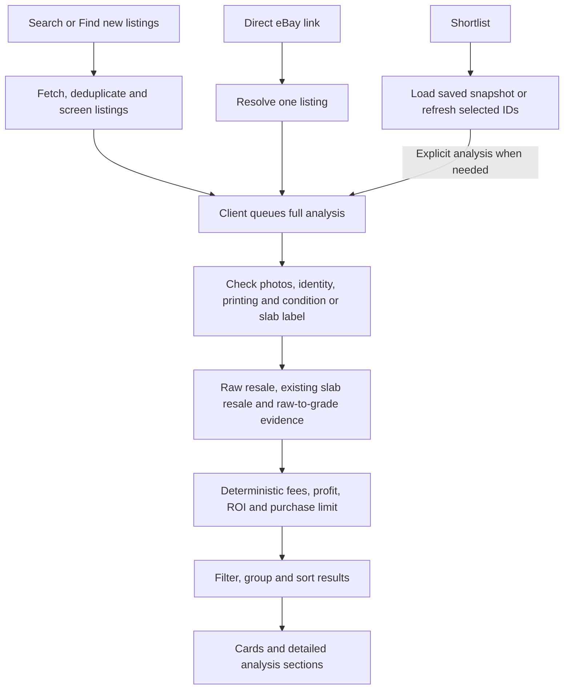

# App workflow and code map

This is a map of the current app after the workflow-organization refactor. The
refactor moves responsibilities into smaller modules; it does not change search,
photo assessment, price evidence, purchase rules, or API limits.

## Follow one listing



1. A normal search streams screened results, recovers eligible pricing failures
   and runs overlooked-listing discovery. **Find new listings** instead reads
   one newest-result page and excludes previously seen IDs before screening.
   The browser queues full assessments according to the user's selected setting;
   screening is preliminary evidence, not a final buying recommendation.
2. A direct listing link resolves only that listing. Shortlist load/save uses
   local snapshots; selected refresh checks current eBay terms without starting
   new paid photo work. These paths do not silently launch a broad search.
3. Full analysis loads/reuses photo evidence, identifies the exact card and
   printing, and resolves supported metadata gaps. Raw cards receive independent
   condition answers and cautious selection. Slabs use their actual grader and
   label grade rather than an imagined raw-card grade.
4. Price evidence is assembled for the applicable resale paths. The money layer
   then calculates expenses, profit, return and the item-price ceiling. The client
   can change profit/ROI targets using those numbers without new provider calls.
5. Shared result rules and client selectors determine the visible groups. Card
   and detail components present that result; they do not independently appraise
   cards or invent new buying decisions.

## Where to read or change code

All paths below are relative to the repository root.

| Responsibility | Main files | Boundary |
| --- | --- | --- |
| HTTP routes and stream messages | `server/app.ts`, `client/src/api.ts` | Keep transport validation and cancellation separate from valuation. |
| Normal search and extra discovery | `server/deals/search.ts`, `find-deals.ts`, `dig.ts` | `find-deals.ts` owns search retrieval/filtering/concurrency; `dig.ts` finds overlooked listings. |
| New-inventory scan and history | `server/deals/new-listings.ts`, `server/search/history.ts` | Deduplicate before provider work; preserve the newest-search cache and reserve. |
| Query interpretation and criteria | `server/search/intent.ts`, `server/search/relevance.ts`, `shared/search-criteria.ts` | Seller keywords and requested slab grades are not verified photo evidence. |
| One-listing screening | `server/deals/screen-listing.ts`, `server/deals/prescreen.ts` | Title, main-photo, detail, shipping and preliminary-price checks; compatibility exports remain in `find-deals.ts`. |
| Direct links and shortlist | `server/listings/resolve.ts`, `server/shortlist/service.ts`, `server/shortlist/store.ts` | Isolated listing lookup, durable snapshots and targeted refresh. |
| Full assessment | `server/analysis/evaluate.ts`, `rules.ts`, `condition-runs.ts`, `resolve-evidence.ts`, `authenticity.ts` | Coordinate and validate evidence; preserve identity/authenticity blockers. |
| AI calls and identity rules | `server/ai/openai.ts`, `server/ai/policy.ts`, `server/identity/` | Model/task routing and photo schemas are distinct from canonical identification and label checks. |
| Raw resale evidence | `server/pricing/raw-comps.ts`, `raw-prices.ts`, `server/ai/sold-condition.ts` | Match condition/printing/finish; keep any market-price fallback labeled. |
| Existing slabs and grading scenarios | `server/pricing/graded-comps.ts`, `active-comps.ts` | Exact grader/grade sold evidence; current-listing references remain separate from sold prices. |
| Shared sold-evidence rules | `server/pricing/sold-comps.ts` | Pure comp rejection, median, outlier and summary helpers shared by raw/graded pricing. Provider access stays outside this module. |
| Money and purchase decisions | `shared/money/underwriting.ts`, `config.ts`, `offer.ts`, `rating.ts`, `targets.ts` | Deterministic calculations shared by server and browser. |
| App orchestration | `client/src/App.tsx`, `client/src/analysis-state.ts` | Requests, queues, cancellation and loading/error/completed state. |
| Search display and settings | `client/src/search/results.ts`, `settings.ts`, `presentation.ts`, `SearchControls.tsx`, `TargetFields.tsx` | Pure result selectors, preferences, labels and controls; no provider calls. |
| Cards and analysis details | `client/src/components/DealCard.tsx`, `DetailPanel.tsx`, `components/analysis/` | `AnalysisDetails` composes financial, evidence, price and offer sections with shared presentation primitives. |
| Liquidity/activity labels | `server/pricing/activity.ts`, `shared/liquidity.ts` | Distinguish matched-sale samples from broader market observations. |

## Invariants to preserve

- **Identity before price:** name, set, collector number, printing, finish and
  relevant slab label must match the chosen evidence. Reprints, qualifiers,
  counterfeit indicators and material disagreements retain their safeguards.
- **Three resale paths stay distinct:** raw resale uses assessed raw condition;
  existing slab resale uses that slab's grader/grade; raw-to-grade scenarios use
  configured submission services and fees. The PSA/CGC submission list does not
  exclude an already-certified BGS or TAG slab from resale analysis.
- **Missing evidence stays visible:** do not turn missing sales into a price,
  treat asking prices as completed sales, or describe a market fallback as a
  verified sold median. Retain existing evidence thresholds and labeled
  fallbacks rather than changing their policy during a refactor.
- **Money stays in code:** photos do not set fees, profit or ROI. Grade scenario
  weights are assumptions, not measured odds. An upper grade bound is a
  possibility, not the likely outcome or a certified grade.
- **Offers remain conditional:** an unaccepted Best Offer is separate from a
  deal at asking price. Preserve the maximum 10% discount and explicit amount.
  The app does not submit bids, offers or seller messages automatically.
- **Requests stay bounded:** `server/ebay/api.ts` reserves every Browse call
  through `usage.ts` and `daily-budget.ts`. Optional work preserves the daily
  reserve; cached reads do not consume Browse calls. Preserve cancellation,
  shared in-flight work, cooldowns and user-selected AI work limits.
- **Reuse has an evidence boundary:** `server/analysis/store.ts` checkpoints
  model answers; `shared/listing-evidence.ts` ties them to listing/photo inputs.
  `shared/pricing-freshness.ts` separates pricing, photo and condition revisions.
  Repricing must not discard unchanged paid photo work. Changed photos or stale
  prices must not keep old purchase advice merely because a card ID matches.
- **Preserve local state:** caches, assessments and the shortlist normally live
  under ignored `data/`; `POKEMON_FLIPPER_DATA_DIR` can select another directory.
  Do not clear that folder, `.env`, or the account-wide quota ledger as cleanup.

## Reading order

Start with `client/src/App.tsx` and `server/app.ts` to see which user action sends
which request. Follow a normal search through `server/deals/search.ts`,
`find-deals.ts` and `screen-listing.ts`. Then read `server/analysis/evaluate.ts`,
`server/identity/card-identity.ts` and the applicable pricing module. Finally read
`shared/money/underwriting.ts`, `shared/analysis.ts`,
`client/src/search/results.ts` and the relevant card/detail section.

For a bug, trace the same listing ID and evidence versions through that chain.
A missing card can be a search/criteria filter, queue state, evidence blocker,
pricing failure, or display group; changing the card component alone cannot fix
all of those causes.

## Verify without a live marketplace run

Run from the repository root:

```sh
npm test
npm run typecheck
npm run build
git diff --check
```

The automated tests use controlled fixtures and mocked provider transports.
These checks do not start a live search or intentionally call paid providers;
tests/builds may write local fixtures or ignored output. For screening changes,
start with the existing `test/deals/`, `test/search/` and cancellation tests.
For result selectors use `test/client/search-results.test.ts`; money changes
require the existing `test/money/` coverage. Broaden to the full suite before a
release.

`npm run evaluate`, `npm run consistency`, review scripts, and searches or
analysis actions in a running app can use real providers. They are not needed
just to verify a mechanical extraction. Keep live validation separate and record
its provider-request counts and limitations.

Recorded sales and activity do **not** establish when this particular copy will
sell. This architecture does not add or guarantee a 30–60 day resale forecast.
