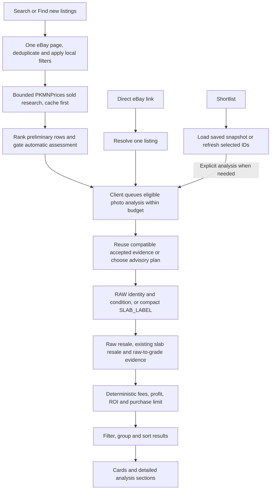

# App workflow and code map

This maps the current bounded HTTP workflow. Searches research recent sold
prices before admitting automatic photo work, while final advice still requires
the applicable identity, condition or slab-label evidence. The app, single-listing
CLI and benchmark use the same evaluator. Older request writers are retired;
small compatibility readers preserve already-paid evidence.

## Follow one listing



1. Normal HTTP search and **Find new listings** use the bounded path in
   `find-deals.ts`: one page of up to 200 eBay results, local/cached metadata
   exclusions and at most 50 retained matching rows. Confident preliminary
   price exclusions free slots for later summaries from that same 200-summary
   window. Refill batches share one screening session and its allowance; they
   never fetch another source page just to fill slots. New-inventory scans also
   exclude previously seen IDs. Buy It Now results prefer newly listed inventory;
   automatic auctions must fall within the fixed search-start 12-hour window.
2. Before candidates are emitted to the browser, `price-first.ts` runs shared
   sold research with at most four candidates in flight. Its source permits
   64 uncached PKMNPrices requests including catalog work, and adaptive reads of
   up to four 20-sale pages per requested market when the preceding pages lack
   three eligible matched sales. It stops once a scope has enough usable
   observations; cached pages from final valuation can satisfy follow-up reads. SQL/file response caches and shared
   catalog/market work avoid repeated requests. This stage calls neither AI nor
   eBay Browse. The retired broad-discovery and automatic pricing-recovery
   branches are no longer alternative search paths.
3. Exact slab grader, grade, printing and finish scopes stay separate. Medians
   rank candidates; only three or more matched sales within 90 days in one
   explicit scope can reject a listing using the upper observed resale value
   after costs. A 180-day fallback can inform priority but cannot hard-reject.
   Unknown purchase shipping uses $0 for conservative exclusion and is disclosed;
   it is not a confirmed free-delivery quote. Changing targets reapplies the same
   retained references locally rather than fetching sales again.
   Raw sold-title condition buckets remain separate priority references, without
   assigning the live card a condition or numeric grade. Unspecified-condition
   sales are context only. Raw comparisons cannot reject unassessed grading or
   premium-printing upside.
4. At least three eligible matched sold observations authorize automatic photo
   work. Missing/deferred evidence stays in Sorting without an automatic paid
   request, except the existing focused-review exception for a raw First Edition
   Base Set lead priced at $10 or less. The browser considers eligible loaded
   rows with two assessments in flight, reuses saved evidence first and shares
   the persistent $0.02 AI cap. Fifty metadata rows do not imply fifty paid
   assessments. All nested Browse work shares the separate 50-request ceiling for new searches
   per search and account-wide daily quota protection.
5. A direct listing link resolves only that listing. Shortlist load/save uses
   stored snapshots; selected refresh checks current eBay terms without starting
   new paid photo work. These paths do not silently launch a broad search.
6. `bounded-plan.ts` uses seller metadata only to choose requested work. RAW
   preserves the original combined request, six-photo selector and cache key,
   with a 2,200-token output maximum. SLAB_LABEL checks the first two unique
   photos using a separate version/schema and a 1,600-token output maximum;
   condition must be null and no future grade or raw category is requested.
   Both retain exact-input preflight and the same persistent spending guard.
7. Before dispatch, the evaluator considers valid compatible combined and
   compact shared readings, choosing the newest answer with its source selector
   and original photo indices. Strong full legacy evidence retains priority.
   Accepted combined/raw evidence remains valid; a compact reading establishing
   an actual slab can also satisfy work routed as RAW by advisory metadata.
   Compact raw/unknown-holder evidence cannot substitute for a raw-condition
   assessment. Corrupt evidence fails closed instead of becoming a paid cache
   miss, and freshness checks recognize the new compact version.
8. Physical holder evidence determines the final route. An actual slab uses
   its photographed grader and certified grade, with no invented raw grading.
   If a compact check disproves the seller's slab claim, the evaluator retains
   the truthful result without automatically buying a raw fallback. Raw as-is
   and supported grading-upside paths retain their existing pricing behavior;
   a supported raw condition can be priced with a null numeric grade range.
9. Price evidence is assembled for the applicable resale paths. The money layer
   then calculates expenses, profit, return and the item-price ceiling. The client
   can change profit/ROI targets using those numbers without new provider calls.
10. Shared result rules and client selectors determine the visible groups. Card
   and detail components present that result; they do not independently appraise
   cards or invent new buying decisions.

## Where to read or change code

All paths below are relative to the repository root.

| Responsibility | Main files | Boundary |
| --- | --- | --- |
| HTTP routes and stream messages | `server/app.ts`, `client/src/api.ts` | Keep transport validation and cancellation separate from valuation. |
| Normal search | `server/deals/search.ts`, `find-deals.ts` | One source page and one bounded pipeline for HTTP and diagnostics; no legacy broad-discovery branch. |
| New-inventory scan and history | `server/deals/new-listings.ts`, `server/search/history.ts` | Deduplicate before provider work; preserve the newest-search cache and reserve. |
| Query interpretation and criteria | `server/search/intent.ts`, `server/search/relevance.ts`, `shared/search-criteria.ts` | Seller keywords and requested slab grades are not verified photo evidence. |
| Local metadata screening | `server/deals/screen-listing.ts` | Saved/local readings only, without new AI or listing-detail calls. `prescreen.ts` remains behind the compatibility pricing-retry endpoint, not normal admission. |
| Sold-price-first admission | `server/deals/price-first.ts`, `server/pricing/screening-sales.ts`, `shared/money/sold-screen.ts` | Shared matched sold references precede browser emission; public observations stay separate from private fee/target calculations and verified photo identity. |
| Screening price transport | `server/pricing/pkmnprices.ts` (`createScreeningPriceSource`) | Cache first, 64 uncached requests including catalog work within the all-stage 128-request new-search allowance, adaptive sparse-market recovery up to four 20-sale pages; no AI/Browse calls or automatic retry loop. |
| All-stage price accounting | `server/pricing/research-budget.ts`, `shared/pricing-usage.ts` | Per-search durable reservations before transport; actual credits from provider headers, cached responses remain in SQL/file storage. |
| Direct links and shortlist | `server/listings/resolve.ts`, `server/shortlist/service.ts`, `server/shortlist/store.ts` | Isolated listing lookup, durable snapshots and targeted refresh. |
| Advisory assessment planning | `server/analysis/bounded-plan.ts` | Stable original RAW selection/key plus compact SLAB_LABEL plan; seller metadata chooses request scope, never the physical holder or final certified grade. |
| Bounded request/schema | `server/ai/bounded-assessment.ts` | Original RAW body/schema retained; compact label schema forces null condition. Both delegate guarded structured transport to `openai.ts`. |
| Photo assessment | `server/analysis/bounded-evaluate.ts`, `rules.ts` | One evaluator owns saved-evidence reuse, physical-holder routing and pricing; no automatic paid raw fallback after a disproved slab claim. |
| Older paid evidence | `server/analysis/legacy-evidence.ts`, `store.ts`, `resolve-evidence.ts` | Retain exact version identifiers, saved record shapes and deterministic correction readers without the old request writers. |
| Explicit deeper photo review | `server/analysis/deeper-review.ts`, `server/ai/deeper-photo-review.ts` | Keep the original assessment and a separately keyed focused report; no broad discovery. |
| Isolated model comparison | `scripts/compare-saved-models.ts`, `server/analysis/model-experiment.ts`, `server/ai/focused-printing-experiment.ts` | Explicit saved-example diagnostics; immutable inputs, private additive evidence and original spending allowances. Does not change production routing or accepted assessments. |
| AI transport and identity rules | `server/ai/openai.ts`, `server/ai/policy.ts`, `server/identity/` | Exact preflight, spending and SDK dispatch remain distinct from canonical identification and label checks. |
| Raw resale evidence | `server/pricing/raw-comps.ts`, `raw-prices.ts`, `server/ai/sold-condition.ts` | Match condition/printing/finish; reuse saved sold-copy findings and keep any market-price fallback labeled. No new sold-photo writer. |
| Existing slabs and grading scenarios | `server/pricing/graded-comps.ts` | Exact grader/grade sold evidence; asking references in older saved records remain distinct from sales. |
| Shared sold-evidence rules | `server/pricing/sold-comps.ts` | Pure comp rejection, median, outlier and summary helpers shared by raw/graded pricing. Provider access stays outside this module. |
| Money and purchase decisions | `shared/money/underwriting.ts`, `config.ts`, `offer.ts`, `rating.ts`, `targets.ts` | Deterministic calculations shared by server and browser. |
| App orchestration | `client/src/App.tsx`, `client/src/analysis-state.ts` | Requests, queues, cancellation and loading/error/completed state. |
| Search display and settings | `client/src/search/results.ts`, `settings.ts`, `presentation.ts`, `SearchControls.tsx`, `TargetFields.tsx` | Pure result selectors, preferences, labels and controls; no provider calls. |
| Cards and analysis details | `client/src/components/DealCard.tsx`, `DetailPanel.tsx`, `components/analysis/` | `AnalysisDetails` composes financial, evidence, price and offer sections with shared presentation primitives. |
| Liquidity/activity labels | `shared/liquidity.ts` | Describe retained matched-sale samples honestly; a broader volume fetch no longer runs as a separate writer. |

The manual pricing-retry endpoint, trusted ticket consumer and UI remain for
compatibility. The current bounded price-first path already did not issue new
tickets before this cleanup. Reconnecting an explicit bounded retry or retiring
that surface remains a separate task; preserving the consumer does not mean
normal searches now offer working retries or automatic price recovery.

## Invariants to preserve

- **Preliminary research is not verified identity:** seller claims can select
  sold research before paid photos. Name, set, number, printing, finish and the
  applicable slab label must match the evidence used for final advice. A strong
  physical reading can resolve wrong seller metadata; genuine ambiguity stays
  unresolved. Uncertain preliminary scopes cannot exclude premium-printing
  upside or blend different printings and finishes into one valuation.
- **Three resale paths stay distinct:** raw resale uses assessed raw condition;
  existing slab resale uses that slab's grader/grade; raw-to-grade scenarios use
  configured submission services and fees. The PSA/CGC submission list does not
  exclude an already-certified BGS or TAG slab from resale analysis.
- **Claims select work; photos select the route:** a label-only request always
  returns null condition. Observing an actual slab authorizes exact-grader/grade
  pricing, never seller metadata alone. Observing a raw card in that request
  does not authorize another paid assessment automatically or invent condition.
- **Missing evidence stays visible:** do not turn missing sales into a price,
  treat asking prices as completed sales, or describe a market fallback as a
  verified sold median. Missing/deferred screening evidence does not buy photo
  work by default. Explicit TCGplayer raw quotes and asking-only slab references retain scenario
  math but cannot independently create Deals or final rejections. Price-only
  reference gaps remain Sorting; physical risks retain their review status.
  Supported independent routes and sparse matched sales retain their existing
  behavior. Unknown downside is shown as unknown. Legacy prices without a
  recorded basis remain readable for compatibility.
- **Money stays in code:** photos do not set fees, profit or ROI. Grade scenario
  weights are assumptions, not measured odds. An upper grade bound is a
  possibility, not the likely outcome or a certified grade.
- **Offers remain conditional:** an unaccepted Best Offer is separate from a
  deal at asking price. Preserve the maximum 10% discount and explicit amount.
  The app does not submit bids, offers or seller messages automatically.
- **Requests stay bounded:** the sold-screen source's 64-request sublimit
  includes uncached catalog calls; final valuation and retries share one durable
  128-request allowance per new search UUID. Old 64-request price ledgers and
  25-request Browse ledgers preserve their original limits and counters.
  Failed/unknown attempts remain counted;
  credits come from provider response headers, independently of request counts.
  Cached response reads consume neither. The ledger is local to the configured
  key and does not establish provider-wide accounting across key rotation or
  independent replicas. It does not replace the persistent two-cent AI
  cap or the 50 actual Browse requests per new search. `server/ebay/api.ts` reserves
  Browse calls through `usage.ts` and `daily-budget.ts`; optional work preserves
  the daily reserve. Cached reads do not consume Browse calls. Cancellation
  blocks later dispatch while accepted responses finish saving for reuse.
- **Quota warnings use existing observations:** `server/lib/provider-usage.ts`
  stores account-hashed first/last minute samples for a fifteen-minute window.
  The UI warns below 20% remaining or after a 5% observed daily-allowance burst.
  Completed PKMN response headers and existing eBay reconciliation/reservations
  supply samples. PKMN countdown resets are anchored to response completion,
  not UI polling. Local `/api/ai-usage` reads expose warnings while discovery or
  assessment runs; no extra provider poll is added. Stale, expired, corrupt or
  unobserved data does not claim a current balance. Telemetry failures cannot
  block an accepted response or trigger repeat analysis.
- **Reuse has an evidence boundary:** `server/analysis/store.ts` checkpoints
  model answers; `shared/listing-evidence.ts` ties them to listing/photo inputs.
  `shared/pricing-freshness.ts` separates pricing, photo and condition revisions.
  Repricing must not discard unchanged paid photo work. Changed photos or stale
  prices must not keep old purchase advice merely because a card ID matches.
  Compact and combined answers preserve their source selectors and original
  photo indices; compatibility is not permission to relabel unsupplied photos
  as assessed or to overwrite stronger accepted evidence with a weaker result.
- **Reuse the selected storage backend:** shared provider responses and photo
  evidence can use Azure SQL or local files; owner financial evaluations remain
  separate. This price-first step adds no long-term sold-observation table or
  migration and does not complete the wider AI research/market-history roadmap.
  Existing local ledgers and shortlist state under ignored `data/` remain
  necessary. Do not clear that directory, `.env` or quota accounting as cleanup.

## Reading order

Start with `client/src/App.tsx` and `server/app.ts` to see which user action sends
which request. Follow a normal search through `server/deals/search.ts`,
`find-deals.ts`, `screen-listing.ts`, `price-first.ts` and
`server/pricing/screening-sales.ts`. Then read
`server/analysis/bounded-plan.ts`, `server/ai/bounded-assessment.ts`,
`server/analysis/bounded-evaluate.ts`, `server/identity/card-identity.ts` and the
applicable pricing module. Finally read
`shared/money/underwriting.ts`, `shared/analysis.ts`,
`client/src/search/results.ts` and the relevant card/detail section.

For a bug, trace the same listing ID and evidence versions through that chain.
A missing card can be a search/criteria filter, queue state, evidence blocker,
pricing failure, or display group; changing the card component alone cannot fix
all of those causes.

## Verify without a live marketplace run

Run from the repository root:

```sh
npm test
npm run typecheck
npm run build
git diff --check
```

The automated tests use controlled fixtures and mocked provider transports.
These checks do not start a live search or intentionally call paid providers;
tests/builds may write local fixtures or ignored output. For screening changes,
start with the existing `test/deals/`, `test/search/` and cancellation tests.
For result selectors use `test/client/search-results.test.ts`; money changes
require the existing `test/money/` coverage. Broaden to the full suite before a
release.

`npm run evaluate`, the bounded-search benchmark, and searches or analysis
actions in a running app can use real providers. They are not needed
just to verify a mechanical extraction. Keep live validation separate and record
its provider-request counts and limitations.

Recorded sales and activity do **not** establish when this particular copy will
sell. This architecture does not add or guarantee a 30–60 day resale forecast.
The compact route also does not establish a full-search cost saving or repair
every photo/identity judgment. A controlled cost benchmark is recorded in
`search-cost-benchmark-2026-11-03.md`; useful-deal validation, deferred
early-completion/English/visibility reports and the positive-deal example remain
separate work.

## Continuing a measured diagnostic

`scripts/bounded-search-benchmark.ts --live --resume <report.json>` reruns the
normal bounded search/evaluator under the original search ID and query. It
retains existing AI, Browse and all-stage pricing counters, uses accepted
photo evidence, and never creates a replacement allowance. `--replay` remains
strictly saved-only, disallowing all provider/image/preflight requests. Private
reports retain before/after counts and transport costs.

`scripts/compare-listing-priority.ts --live --report <report.json>` separately
tests one compact GPT-6 Luna text ranking of already eligible saved Buy It Now
metadata, after existing free filters. It cannot change app queue order. Input
excludes photos and later assessment answers; output is at most eight known
candidate keys and reason codes. Separate experiment storage preserves accepted
photo findings. Its original search's generation allowance, exact preflight,
dispatch-only Stop and maximum output reservation still apply. `--replay`
cannot buy missing work. Batch/Flex are not enabled. Measurements and limits are
recorded in `catalog-and-evidence-validation-2026-11-04.md`.
